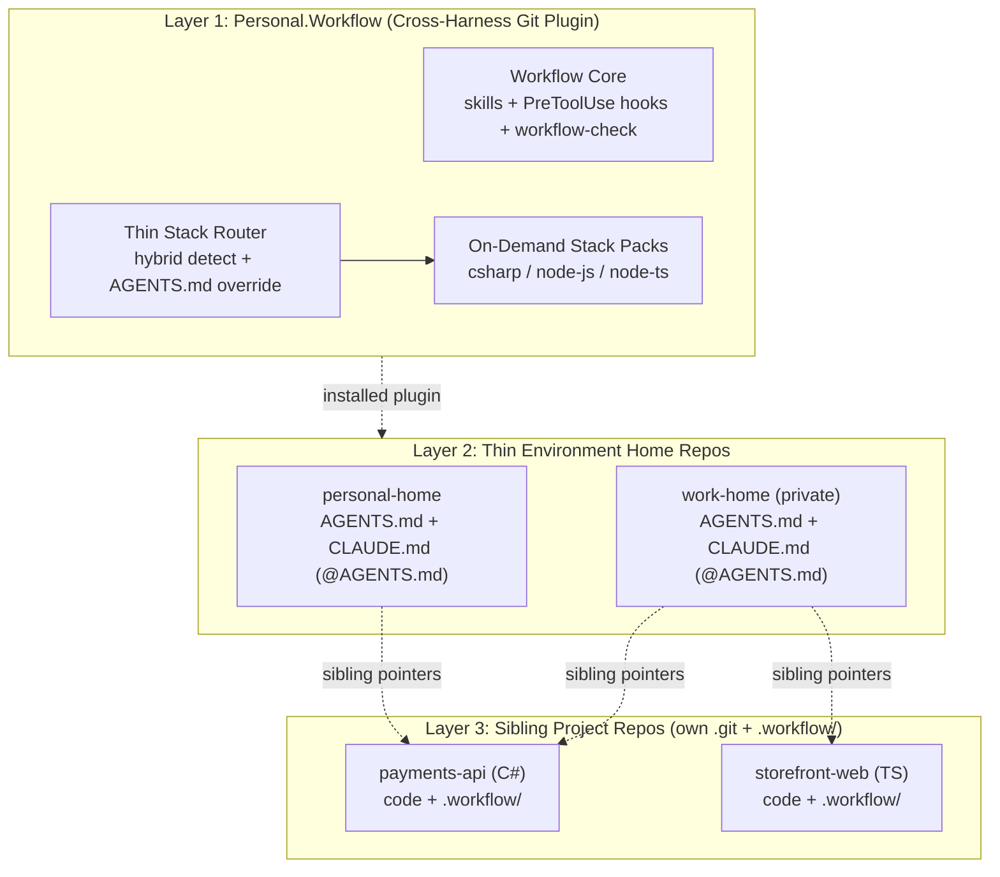
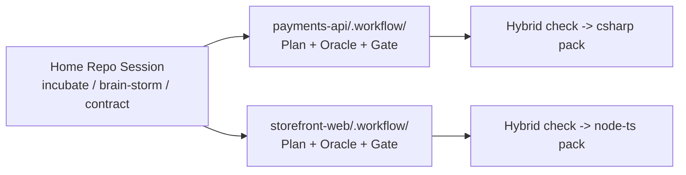

# Incubation - Home Repo Workflow

Status: incubating
Started: 2026-11-22
Updated: 2026-11-22

## Spark
- Explored adopting Matt Pocock's Home Repo Pattern so `Workflow Core` skills and agents stay put in one place while project repositories swap in and out, without breaking multi-stack `Language Add-on` support or creating nested-repo git chaos.
- Added two key real-world constraints during exploration: multi-repo sessions from one hub are a definite goal, and the setup must stay portable across personal and work machines using both **VS Code + GitHub Copilot** and **Claude Code** (not locked into local-only machine config).

## Current Mental Model
- Separate the **reusable Workflow Engine** from **environment-specific Home Repos** and **sibling project repos** in a 3-layer architecture (**Model A**):
  1. **Layer 1 — `Personal.Workflow` as a Git-hosted Cross-Harness Plugin:** Packages `Workflow Core` skills, hooks, `workflow-check`, and **on-demand `Language Add-on` stack packs** in a Claude-format plugin (`.claude-plugin/plugin.json`), which VS Code Copilot, Copilot CLI, and Claude Code all recognize natively. Keeps stack packs outside the always-loaded `skills/` catalog and routes to them via hybrid detection (marker files by default + explicit `AGENTS.md` override for greenfield or polyglot repos) plus a single thin router skill.
  2. **Layer 2 — Thin Environment Home Repos (`personal-home`, `work-home`):** Separate small git repos holding sibling repo pointers in `AGENTS.md` (with a 1-line `CLAUDE.md` importing `@AGENTS.md`), shared environment docs, and cross-repo ideation/contracts. Keeps private work pointers completely separate from personal repos.
  3. **Layer 3 — Sibling Project Repos:** Normal independent git repositories sitting beside the Home Repo on disk (no nested `.git` folders inside the Home Repo). Each repo owns its own `Workflow Folder` (`.workflow/`), repo-specific `AGENTS.md`, git history, branches, and PRs.
- **Cross-repo execution model ("Coordinate in Home, Execute per Repo"):** Use the Home Repo session to incubate, brain-storm, and agree cross-repo contracts; execute `Plan`, `Phase`, `Card`, `Oracle`, `Tests locked`, and `Gate` inside each target repo's own `.workflow/` so repos remain independently testable and mergeable. Single-repo work can also open a project repo directly with the plugin active.

## What Fits vs. What Clashes

| Dimension | External / Initial Idea | Our Context & Take |
| --- | --- | --- |
| **Repo physical layout** | Home Repo holds `AGENTS.md` pointers to **sibling** repos on disk (cloning on demand if missing); gitignored nested folders and submodules are optional variants. | **Fits cleanly.** Sibling pointers eliminate nested-`.git` confusion and keep each project's branches, worktrees, and PRs intact. |
| **Where skills live** | Shared skills live in the Home Repo; user folders (`~/.claude/skills`) are treated as a local stopgap. | **Refined for home + work.** Packaging `Personal.Workflow` as a Git-hosted cross-harness plugin gives git-versioned portability across machines *and* lets `personal-home` and `work-home` stay separate without duplicating skills. |
| **Multi-stack `Language Add-on`s** | Not addressed by Matt's pattern; `Personal.Workflow` currently copies only one stack's add-ons per repo. | **Reshaped.** Keep [language-addons/](../../language-addons) as on-demand stack packs outside auto-loaded `skills/`. Good news: [mutation-addon.mjs](../../.github/skills/work-planner/scripts/mutation-addon.mjs) already filters by `- **Mutation stack:**`, though it currently scans `.github/skills/` and `cwd`. |
| **Where `.workflow/` lives** | Shared docs live in the Home Repo; repo-specific docs stay in each child repo. | **Per-repo execution.** Keep `Plan`, `Oracle`, `Tests locked`, and `Gate` inside each sibling repo's `.workflow/`, using the Home Repo only to coordinate cross-repo thinking and contracts. |
| **VS Code multi-root `.code-workspace`** | Considered as an alternative to Home Repo pointers. | **Weak foundation today.** Official VS Code docs do not guarantee cross-root skill/hook sharing, and the Agents window does not yet support multi-root sessions. |
| **Cross-harness (Copilot + Claude Code)** | Matt's pattern notes using `AGENTS.md` or `CLAUDE.md` per harness. | **Mostly shared, one divergence.** Claude-format plugins (`.claude-plugin/plugin.json`), `AGENTS.md` + `CLAUDE.md` (`@AGENTS.md`), and PascalCase `PreToolUse` hooks with `${CLAUDE_PLUGIN_ROOT}` bridge both harnesses—but custom agent YAML frontmatter still differs. |
| **Existing `cwd` assumptions in `Personal.Workflow`** | Skills, hooks, and scripts currently assume `cwd` is the target project repo. | **Concrete clashes to adapt:** [guard-locked-tests.mjs](../../.github/hooks/scripts/guard-locked-tests.mjs) uses `cwd`'s git root and skips `..` paths (silently bypassing sibling `Oracle` locks!); [workspace.mjs](../../.github/tools/workflow-check/src/workspace.mjs) walks up from `cwd`; [locked-tests.json](../../.github/hooks/locked-tests.json) uses a repo-relative script path. |

## Tensions & Tradeoffs
- **Silent `Oracle` bypass on sibling edits:** [guard-locked-tests.mjs](../../.github/hooks/scripts/guard-locked-tests.mjs) currently resolves git root from `cwd` and ignores any edited path starting with `..`. Under a Home Repo, the hook must resolve the git root from the *edited file's directory* instead—and we still need to verify live that both VS Code Copilot and Claude Code fire `PreToolUse` hooks for edits outside `cwd` (inferred from docs, not explicitly guaranteed).
- **Duplicate-hook risk in Copilot:** Official docs note Copilot reads both `.github/hooks/` and repo `.claude/settings.json` hooks; keeping the hook strictly inside the plugin manifest avoids double-firing.
- **Dual-harness custom agents (`.github/agents/`):** All 5 workflow agents ([coder.agent.md](../../.github/agents/coder.agent.md), [repo-scout.agent.md](../../.github/agents/repo-scout.agent.md), [test-author.agent.md](../../.github/agents/test-author.agent.md), [test-reviewer.agent.md](../../.github/agents/test-reviewer.agent.md), [planner.agent.md](../../.github/agents/planner.agent.md)) have harness-agnostic prompt bodies, but their YAML frontmatter (`tools`, `model`, `reasoning-effort`, `user-invocable`, file extension) diverges between Copilot and Claude Code. Avoiding drift implies a single source of truth for prompt bodies plus thin per-harness frontmatter generation/shims.
- **Work enterprise governance:** Policies such as `strictPluginOnlyCustomization`, `allowManagedHooksOnly`, or blocked external GitHub URLs could constrain Model A at work. Clean fallback ladder: Git URL plugin -> local `git pull` folder plugin (**Model A-Local**) -> direct Home Repo / `--add-dir` (**Model B**), with the `Gate` still checking locked tests even if live pre-edit hooks are disabled.
- **Cross-repo `Session Chain` -> per-repo `Plan` handoff:** Still needs a crisp convention for how a Home Repo `brain-storm` or contract links cleanly into two child repos' `.workflow/plans/` without confusing `workflow-check`.

## Sources
- [The Home Repo Pattern (Matt Pocock / AI Hero)](https://www.aihero.dev/the-home-repo-pattern) — Proposes one Home Repo holding shared skills, `AGENTS.md` sibling-repo pointers, and shared docs; validated keeping child repos as siblings rather than nested git repos and motivated git-versioned sharing over `~/.claude/skills`.
- [VS Code Agent Plugins](https://code.visualstudio.com/docs/agent-customization/agent-plugins.md) & [Agent Plugin Reference](https://code.visualstudio.com/docs/agents/reference/agent-plugin-reference.md) — Confirms VS Code Copilot supports Git/local-folder plugin installs, auto-detects `.claude-plugin/plugin.json` and Agent Plugins 1.0, and supports `${PLUGIN_ROOT}` / `${CLAUDE_PLUGIN_ROOT}`.
- [VS Code Agent Harnesses](https://code.visualstudio.com/docs/agents/run/agent-harnesses.md), [Hooks](https://code.visualstudio.com/docs/agent-customization/hooks), & [Agents Window](https://code.visualstudio.com/docs/agents/run/agents-window.md) — Confirms VS Code Copilot shares runtime/hook semantics with Copilot CLI, supports PascalCase `PreToolUse`, and does not yet support multi-root sessions in the Agents window.
- [GitHub Copilot CLI Hooks Reference](https://docs.github.com/en/copilot/reference/hooks-reference) & [CLI Command Reference](https://docs.github.com/en/copilot/reference/copilot-cli-reference/cli-command-reference) — Confirms Copilot CLI reads `.github/skills`, `.claude/skills`, and `.agents/skills`, supports `--add-dir`, reads repo `.claude/settings.json` hooks (duplicate-firing caveat), and supports Claude-style `PreToolUse` matcher/payload semantics.
- [Claude Code Skills](https://code.claude.com/docs/en/skills.md), [Memory / AGENTS.md](https://code.claude.com/docs/en/memory.md#agents-md), [Permissions & Additional Directories](https://code.claude.com/docs/en/permissions.md), & [Plugins Loading](https://code.claude.com/docs/en/plugins/loading.md) — Confirms Claude Code reads `.claude/skills/`, bridges `AGENTS.md` via `@AGENTS.md` in `CLAUDE.md`, grants sibling access via `--add-dir` / `permissions.additionalDirectories` (without loading sibling hooks), and supports Git/local-path plugin marketplaces.

## Open Threads
- **Work Policy & Dual-Harness 5-Minute Pressure Test** (to run on the work machine before graduating):
  1. **Plugin install probe:** Test `chat.plugins.enabled` + **Chat: Install Plugin from Source** (Git URL vs. local folder) in VS Code Copilot, and `/plugin` in Claude Code.
  2. **Sibling-repo access probe:** From a dummy `work-home`, test reading/editing a file in `../dummy-sibling` in VS Code Copilot (sandbox path persistence) and Claude Code (`/add-dir`).
  3. **Sibling `PreToolUse` hook probe:** Run a 5-line logging-only `PreToolUse` hook (`{}` allow) and confirm it fires in both harnesses for edits in `../dummy-sibling`—and logs **once** (no double-firing) in VS Code Copilot.
  4. **2-agent smoke test (`repo-scout` + `coder`):** Verify `repo-scout` stays read-only on a sibling repo in both harnesses, and `coder` runs on the cheap tier, edits + executes in the sibling repo, and is blocked by the `PreToolUse` hook on a protected test file.
- **Cross-repo spec handoff:** Decide how a cross-repo `brain-storm` / contract in a Home Repo connects cleanly to per-repo `Plan`s without breaking `workflow-check` traceability.
- **Single-source agent packaging:** Decide whether to maintain thin per-harness agent frontmatter manually (only 5 agents) or generate Copilot `.agent.md` and Claude `.md` from one source file.
- **Polyglot repo stack packs:** Confirm how a single repo containing multiple stacks (e.g., `api/` C# + `web/` TS) binds each stack pack to its subdirectory inside `work-planner` and `Gate`.

## Pick Up Here
- Run the 4-step **Work Policy & Dual-Harness Pressure Test** from `Open Threads` on your work machine (VS Code Copilot + Claude Code), then resume this note with what passed or hit org restrictions so we can lock in Model A vs. Model A-Local/Model B and decide whether to graduate into `/brain-storm`.
