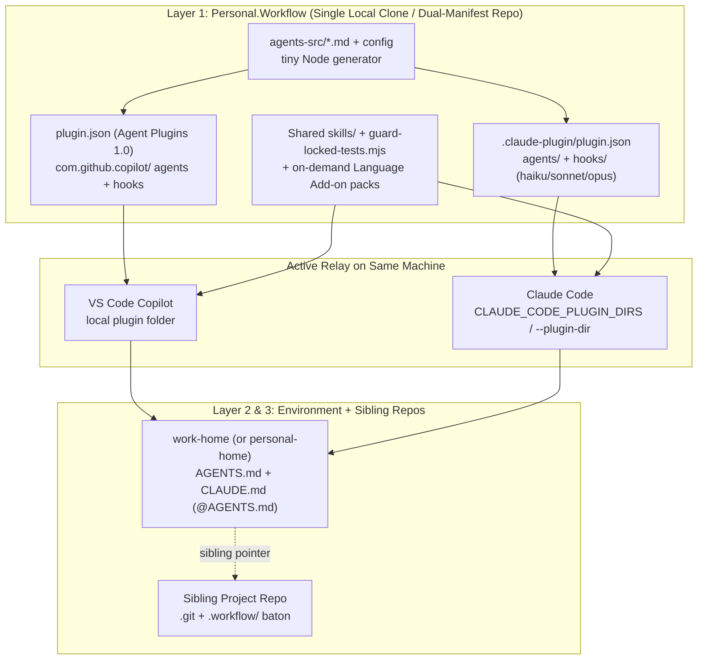
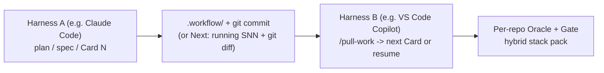

# Incubation - Home Repo Workflow

Status: incubating
Started: 2026-11-22
Updated: 2026-11-22

## Spark
- Explored adopting Matt Pocock's Home Repo Pattern so `Workflow Core` skills and agents stay put in one place while project repositories swap in and out, without breaking multi-stack `Language Add-on` support or creating nested-repo git chaos.
- Added three real-world constraints during exploration: multi-repo sessions from one hub are a definite goal; the setup must stay portable across personal and work machines; and at work we actively **relay back and forth between Claude Code and VS Code Copilot on the same work** (primarily by role/phase due to quotas, rate limits, and model preferences, with occasional mid-Card or mid-conversation quota hits).

## Current Mental Model
- Separate the **reusable Workflow Engine** from **environment-specific Home Repos** and **sibling project repos** in a 3-layer architecture (**Model A**), designed as a **cross-harness relay**:
  1. **Layer 1 — `Personal.Workflow` as a Dual-Manifest Cross-Harness Plugin (single local clone default on dual-harness machines):**
     - The same repository works both as a **single local clone (`Model A-Local`, default whenever Claude Code and VS Code Copilot share a machine)** and as a remote Git-hosted plugin elsewhere. Pointing both harnesses at one local clone (`git pull` once; Claude Code via `CLAUDE_CODE_PLUGIN_DIRS` / `--plugin-dir`, VS Code Copilot via local plugin folder) eliminates plugin cache drift and sidesteps work Git-URL plugin blocks.
     - **Dual-manifest coexistence in one repo:** VS Code Copilot prefers root `plugin.json` (Agent Plugins 1.0 `$schema`) and reads Copilot-specific agents/hooks exclusively from `com.github.copilot/`; Claude Code reads `.claude-plugin/plugin.json` (ignoring root `plugin.json` and `com.github.copilot/`) and reads Claude-specific `agents/` and `hooks/`. Both share the **same portable `skills/`** and **same `guard-locked-tests.mjs` script**.
     - **Single-source agent generator:** Keep the harness-agnostic prompt bodies once (e.g. `agents-src/*.md`) plus one small per-harness frontmatter config (`model`, `tools`, filename), and run a tiny Node generator script to emit both `com.github.copilot/agents/*.agent.md` (multi-vendor Copilot fallback tiers) and Claude `agents/*.md` (`haiku`/`sonnet`/`opus` + Claude tools). This preserves quota-saving cheap-tier delegation in both harnesses with zero prompt drift.
     - Keep `Language Add-on` stack packs outside the always-loaded `skills/` catalog and route to them via hybrid detection (marker files by default + explicit `AGENTS.md` override for greenfield or polyglot repos) plus a single thin router skill.
  2. **Layer 2 — Thin Environment Home Repos (`personal-home`, `work-home`):** Separate small git repos holding sibling repo pointers in `AGENTS.md` (with a 1-line `CLAUDE.md` importing `@AGENTS.md`), shared environment docs, and cross-repo ideation/contracts. Keeps private work pointers completely separate from personal repos.
  3. **Layer 3 — Sibling Project Repos:** Normal independent git repositories sitting beside the Home Repo on disk (no nested `.git` folders inside the Home Repo). Each repo owns its own `Workflow Folder` (`.workflow/`), repo-specific `AGENTS.md`, git history, branches, and PRs.
- **Cross-repo & cross-harness execution model ("Coordinate in Home, Execute per Repo, Relay via `.workflow/`"):**
  - Use the Home Repo session to incubate, brain-storm, and agree cross-repo contracts; execute `Plan`, `Phase`, `Card`, `Oracle`, `Tests locked`, and `Gate` inside each target repo's own `.workflow/` so repos remain independently testable and mergeable.
  - Treat `.workflow/` + git commits as the **relay baton** between Claude Code and VS Code Copilot—no chat history needs to cross harnesses and **zero new handoff files** are needed.
  - For occasional mid-task quota hits: conversations already pause cleanly (`"pause"` in `incubate`, `draft` `Session` in `brain-storm`), and [pull-work](../../.github/skills/pull-work/SKILL.md) already supports interrupted mid-Card resume (`Next: running SNN` accepts dirty `plan.md` + that slice's `Files` and resumes Dispatch via `Done when`, or `git restore` gives a clean rerun).

## What Fits vs. What Clashes

| Dimension | External / Initial Idea | Our Context & Take |
| --- | --- | --- |
| **Repo physical layout** | Home Repo holds `AGENTS.md` pointers to **sibling** repos on disk (cloning on demand if missing). | **Fits cleanly.** Sibling pointers eliminate nested-`.git` confusion and keep each project's branches, worktrees, and PRs intact. |
| **Where skills live & sync** | Shared skills live in the Home Repo; Git-URL plugin installs considered as primary. | **Refined for active dual-harness relay.** Same dual-manifest repo works remotely or locally, but **single local clone (`Model A-Local`)** is the recommended default on dual-harness/work machines so one `git pull` keeps VS Code Copilot and Claude Code in lockstep with zero cache drift. |
| **Dual-harness custom agents** | Single `.claude-plugin/plugin.json` risked frontmatter collisions (`model`, `tools`) across harnesses. | **Solved cleanly via dual manifests + tiny generator.** VS Code reads `com.github.copilot/agents/*.agent.md` via root `plugin.json` (Agent Plugins 1.0); Claude Code reads `agents/*.md` via `.claude-plugin/plugin.json`. A small Node script emits both from one prompt body source so cheap-tier delegation protects quotas in both harnesses without drift. |
| **Mid-task quota switches** | Considered adding a handoff scratchpad file for interrupted Cards. | **Zero new files needed.** [pull-work](../../.github/skills/pull-work/SKILL.md) already permits `Next: running SNN` with dirty `plan.md` + slice `Files` and resumes Dispatch from `Done when` (with `git restore` as an easy reset). Conversations already pause via `incubate` / `draft` `Session`. |
| **Multi-stack `Language Add-on`s** | Not addressed by Matt's pattern; `Personal.Workflow` currently copies only one stack's add-ons per repo. | **Reshaped.** Keep [language-addons/](../../language-addons) as on-demand stack packs outside auto-loaded `skills/`. [mutation-addon.mjs](../../.github/skills/work-planner/scripts/mutation-addon.mjs) already filters by `- **Mutation stack:**`, though it currently scans `.github/skills/` and `cwd`. |
| **Where `.workflow/` lives** | Shared docs live in the Home Repo; repo-specific docs stay in each child repo. | **Per-repo execution.** Keep `Plan`, `Oracle`, `Tests locked`, and `Gate` inside each sibling repo's `.workflow/`, using the Home Repo only to coordinate cross-repo thinking and contracts. |
| **Existing `cwd` & `.github/` assumptions** | Skills, hooks, and scripts assume `cwd` is the target project repo and `Workflow Core` is copied into `.github/`. | **Concrete clashes to adapt:** [guard-locked-tests.mjs](../../.github/hooks/scripts/guard-locked-tests.mjs) uses `cwd`'s git root and skips `..` paths (silently bypassing sibling `Oracle` locks!); [workspace.mjs](../../.github/tools/workflow-check/src/workspace.mjs) walks up from `cwd`; [pull-work](../../.github/skills/pull-work/SKILL.md) hardcodes `.github/skills/pull-work/scripts/...`, `.github/tools/workflow-core/scripts/trace.mjs`, `.github/agents/coder.agent.md`, and `.github/user-interaction.md`, and dispatches Copilot's built-in `code-review` agent. |
| **VS Code multi-root `.code-workspace`** | Considered as an alternative to Home Repo pointers. | **Weak foundation today.** Official VS Code docs do not guarantee cross-root skill/hook sharing, and the Agents window does not yet support multi-root sessions. |

## Tensions & Tradeoffs
- **Silent `Oracle` bypass on sibling edits:** [guard-locked-tests.mjs](../../.github/hooks/scripts/guard-locked-tests.mjs) currently resolves git root from `cwd` and ignores any edited path starting with `..`. Under a Home Repo, the hook must resolve the git root from the *edited file's directory* instead—and we still need to verify live that both VS Code Copilot and Claude Code fire `PreToolUse` hooks for edits outside `cwd`.
- **Plugin-relative paths inside skills:** Moving `Workflow Core` into a plugin means target sibling repos will not contain `.github/skills/...`, `.github/tools/...`, or `.github/user-interaction.md`. Skills like [pull-work](../../.github/skills/pull-work/SKILL.md) and [work-planner](../../.github/skills/work-planner/SKILL.md) will need plugin/skill-relative script and reference resolution instead of repo-relative `.github/` paths.
- **Claude Code skill & agent namespacing:** Claude Code namespaces every plugin component under the manifest `name` (`/<name>:<skill>` and `<name>:<agent>`). Choosing a short plugin `name` (e.g. `pw` or `wf`) keeps slash commands ergonomic, and skill prompts that dispatch `coder`, `repo-scout`, `test-author`, or `test-reviewer` must work cleanly whether the harness exposes bare or namespaced agent IDs.
- **`code-review` agent parity:** `pull-work`'s `Review` step dispatches `code-review` (a built-in agent in Copilot CLI/VS Code). Claude Code needs either a 6th generated plugin agent or a clean main-session review fallback so phase-end reviews stay identical across harnesses.
- **Harness-local file hygiene:** Switching harnesses on the same repo means both may leave local config files (e.g. `.claude/settings.local.json` for `--add-dir` permissions, `.vscode/` tweaks). These must be gitignored (ideally via global gitignore) so switching harnesses never trips `pull-work`'s clean-tree check.
- **Duplicate-hook risk in Copilot:** Official docs note Copilot reads both `.github/hooks/` and repo `.claude/settings.json` hooks; keeping hooks strictly inside each harness's plugin manifest (`com.github.copilot/hooks/hooks.json` and `.claude-plugin` `hooks/hooks.json`) avoids double-firing.
- **Work enterprise governance:** Policies such as `strictPluginOnlyCustomization`, `strictKnownMarketplaces`, or `allowManagedHooksOnly` can silently skip `~/.claude/skills/` plugins or block remote plugin sources (`CLAUDE_CODE_PLUGIN_DIRS` / `--plugin-dir` works unless disabled by admin; `/status` in Claude Code shows whether enterprise managed settings are active). Clean fallback ladder: Dual-manifest local clone (**Model A-Local**) -> Remote Git plugin (**Model A**) -> direct Home Repo / `--add-dir` (**Model B**), with the `Gate` still checking locked tests even if live pre-edit hooks are disabled.
- **Cross-repo `Session Chain` -> per-repo `Plan` handoff:** Still needs a crisp convention for how a Home Repo `brain-storm` or contract links cleanly into two child repos' `.workflow/plans/` without confusing `workflow-check`.

## Sources
- [The Home Repo Pattern (Matt Pocock / AI Hero)](https://www.aihero.dev/the-home-repo-pattern) — Proposes one Home Repo holding shared skills, `AGENTS.md` sibling-repo pointers, and shared docs; validated keeping child repos as siblings rather than nested git repos and motivated git-versioned sharing over `~/.claude/skills`.
- [VS Code Agent Plugins](https://code.visualstudio.com/docs/agent-customization/agent-plugins.md) & [Agent Plugin Reference](https://code.visualstudio.com/docs/agents/reference/agent-plugin-reference.md) — Confirms VS Code supports Git and local-folder plugin installs, prioritizes root `plugin.json` (Agent Plugins 1.0 `$schema`) over `.claude-plugin/plugin.json`, isolates Copilot-specific agents/hooks under `com.github.copilot/` (ignored by other clients), and supports `${PLUGIN_ROOT}` / `${CLAUDE_PLUGIN_ROOT}`.
- [VS Code Agent Harnesses](https://code.visualstudio.com/docs/agents/run/agent-harnesses.md), [Hooks](https://code.visualstudio.com/docs/agent-customization/hooks), & [Agents Window](https://code.visualstudio.com/docs/agents/run/agents-window.md) — Confirms VS Code Copilot shares runtime/hook semantics with Copilot CLI, supports PascalCase `PreToolUse`, and does not yet support multi-root sessions in the Agents window.
- [GitHub Copilot CLI Hooks Reference](https://docs.github.com/en/copilot/reference/hooks-reference) & [CLI Command Reference](https://docs.github.com/en/copilot/reference/copilot-cli-reference/cli-command-reference) — Confirms Copilot CLI reads `.github/skills`, `.claude/skills`, and `.agents/skills`, supports `--add-dir`, reads repo `.claude/settings.json` hooks (duplicate-firing caveat), and supports Claude-style `PreToolUse` matcher/payload semantics.
- [Claude Code Plugin Manifest Reference](https://code.claude.com/docs/en/plugins-reference.md) & [Plugin Loading Reference](https://code.claude.com/docs/en/plugins/loading.md) — Confirms Claude Code reads `.claude-plugin/plugin.json`, namespaces components as `/<name>:<skill>` and `<name>:<agent>`, supports live uncached local folder loading via `CLAUDE_CODE_PLUGIN_DIRS` / `--plugin-dir`, provides `claude plugin validate`, and documents how `strictPluginOnlyCustomization` / `strictKnownMarketplaces` affect `~/.claude/skills/` plugins (checkable via `/status`).
- [Claude Code Skills](https://code.claude.com/docs/en/skills.md), [Memory / AGENTS.md](https://code.claude.com/docs/en/memory.md#agents-md), & [Permissions & Additional Directories](https://code.claude.com/docs/en/permissions.md) — Confirms Claude Code reads `.claude/skills/`, bridges `AGENTS.md` via `@AGENTS.md` in `CLAUDE.md`, and grants sibling access via `--add-dir` / `permissions.additionalDirectories` (without loading sibling hooks).

## Open Threads
- **Work Policy & Dual-Harness 5-Minute Pressure Test** (to run on the work machine before graduating):
  1. **Policy & dual-manifest load probe:** Run `/status` in Claude Code to check `Enterprise managed settings`. Load one local dummy dual-manifest folder (`plugin.json` + `com.github.copilot/` AND `.claude-plugin/plugin.json` + `agents/` + `hooks/`) in **VS Code Copilot** (local plugin folder) and **Claude Code** (`CLAUDE_CODE_PLUGIN_DIRS` / `--plugin-dir` + `claude plugin validate`). Verify each harness loads *only* its own agents/hooks, both see the shared skill, and note Claude's `/<name>:<skill>` / `<name>:<agent>` behavior.
  2. **Sibling-repo access & clean-tree probe:** From a dummy `work-home`, test reading/editing a file in `../dummy-sibling` in VS Code Copilot (sandbox path persistence) and Claude Code (`/add-dir`), and confirm harness-local files (`.claude/settings.local.json`, `.vscode/`) stay gitignored so `git status --porcelain` stays clean.
  3. **Sibling `PreToolUse` hook probe:** Confirm a logging-only `PreToolUse` hook in the dual-manifest plugin fires **once** in VS Code Copilot and **once** in Claude Code for edits in `../dummy-sibling`.
  4. **2-agent + relay smoke test (`repo-scout` + `coder`):** Verify cheap-tier delegation (`haiku` in Claude Code, cheap tier in Copilot) works on a sibling repo in both harnesses, `PreToolUse` blocks a protected test file in both, and stopping mid-edit in one harness resumes cleanly in the other.
- **Plugin-relative scripts & `code-review` parity:** Decide how skills resolve bundled scripts/docs without repo-local `.github/` paths, and whether to add `code-review` as a 6th generated plugin agent for Claude Code parity.
- **Cross-repo spec handoff:** Decide how a cross-repo `brain-storm` / contract in a Home Repo connects cleanly to per-repo `Plan`s without breaking `workflow-check` traceability.
- **Polyglot repo stack packs:** Confirm how a single repo containing multiple stacks (e.g., `api/` C# + `web/` TS) binds each stack pack to its subdirectory inside `work-planner` and `Gate`.

## Pick Up Here
- Run the updated 4-step **Work Policy & Dual-Harness Pressure Test** from `Open Threads` on your work machine (VS Code Copilot + Claude Code), then resume this note with what passed or hit org restrictions so we can lock in the dual-manifest local-clone layout (vs. fallback) and decide whether to graduate into `/brain-storm`.
