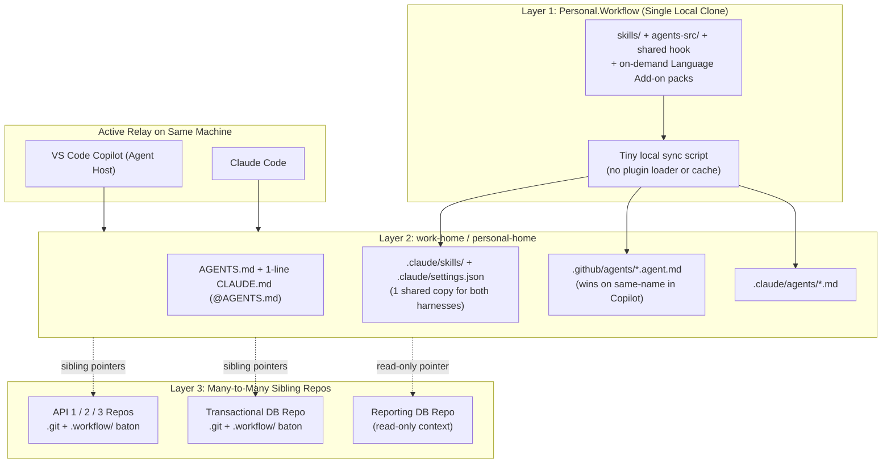
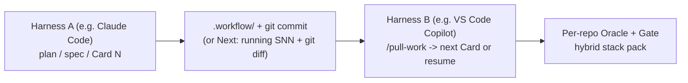

# Incubation - Home Repo Workflow

Status: incubating
Started: 2026-11-22
Updated: 2026-11-22

## Spark
- Explored adopting Matt Pocock's Home Repo Pattern so `Workflow Core` skills and agents stay put in one place while project repositories swap in and out, without breaking multi-stack `Language Add-on` support or creating nested-repo git chaos.
- Added three real-world constraints during exploration: multi-repo sessions from one hub are a definite goal; the setup must stay portable across personal and work machines; and at work we actively **relay back and forth between Claude Code and VS Code Copilot on the same work** (primarily by role/phase due to quotas, rate limits, and model preferences, with occasional mid-Card or mid-conversation quota hits).
- Considered breaking off multi-stack (polyglot single-repo) ahead of Home Repo, but decided **against** splitting it out: the majority of work repos are single-stack, and the real bottleneck is coordinating changes across a **many-to-many sibling repo graph** (e.g., 3 separate API repos sharing 1 writable transactional DB repo, plus an API reading from a 2nd read-only reporting DB repo) alongside dual-harness layout (Copilot + Claude Code).

## Current Mental Model
- Separate the **reusable Workflow Engine** from **environment-specific Home Repos** and **sibling project repos** in a 3-layer architecture, using a **conservative 80/20 Home Repo Sync model** (no agent plugin loader) designed for **cross-harness relay**:
  1. **Layer 1 — `Personal.Workflow` (Single Local Clone + Lightweight Sync):**
     - Keep `Personal.Workflow` as one local clone per machine—the single source of truth for `Workflow Core` (`skills/`, harness-specific `agents/`, shared `hooks/`, scripts, and on-demand `Language Add-on` packs).
     - Instead of packaging as an Agent Plugin, a small local sync script copies/links the right files into each Home Repo (`work-home` / `personal-home`) after `git pull`. This avoids plugin caching in VS Code, `/<plugin>:` command prefixes in Claude Code, and rewriting existing `.github/` script paths.
     - Keep the harness-agnostic agent prompt bodies once plus a small per-harness frontmatter config (`model`, `tools`, filename) so cheap-tier delegation works in both harnesses without prompt drift.
     - Keep `Language Add-on` stack packs outside the always-loaded `skills/` catalog and route to them via hybrid detection (marker files by default + explicit `AGENTS.md` override for greenfield or polyglot repos) plus a single thin router skill.
  2. **Layer 2 — Thin Environment Home Repos (`personal-home`, `work-home`):**
     - Separate small git repos holding sibling repo pointers in `AGENTS.md` (including each sibling's role: co-changed repo, read-only reference repo, or peer-impact repo), shared environment docs, and cross-repo ideation/contracts—keeping private work pointers completely separate from personal repos.
     - **Instruction files (`AGENTS.md` + 1-line `CLAUDE.md`):** Use `AGENTS.md` as the single source of truth plus a 1-line `CLAUDE.md` containing `@AGENTS.md`. Even though Claude Code v2.1.277+ natively reads `AGENTS.md` as a fallback, keeping the 1-line `CLAUDE.md` (`@AGENTS.md`) is deduplicated by Claude Code (never loaded twice), works with `--add-dir` + `CLAUDE_CODE_ADDITIONAL_DIRECTORIES_CLAUDE_MD=1` (where native `AGENTS.md` does *not* load), and prevents `CLAUDE.local.md` from silently shadowing `AGENTS.md`. *(Note: VS Code's `chat.useClaudeMdFile: false` only applies to the legacy Local agent harness, not Copilot CLI / Agent Host, so keeping `CLAUDE.md` to 1 line minimizes any overlap.)*
     - **Verified zero-duplicate synced layout (Copilot Agent Host + Claude Code):**
       - **1 shared `skills/` folder (`.claude/skills/`):** Verified natively discovered in both harnesses, including `/` autocomplete in VS Code Copilot.
       - **1 shared hooks config (`.claude/settings.json`):** Verified that VS Code Copilot Agent Host runs `.claude/settings.json` hooks natively (and ignores `chat.useClaudeHooks: false`, which is Local-harness-only). Do **not** also ship `.github/hooks/` in the Home Repo or Copilot will double-fire; use one shared `.claude/settings.json` hook for both harnesses *(pending deny-payload verification for `guard-locked-tests.mjs`)*.
       - **Separate `agents/` (`.github/agents/*.agent.md` + `.claude/agents/*.md`):** Verified that same-name `.github/agents/*.agent.md` takes precedence over `.claude/agents/*.md` in VS Code Copilot Agent Host *(caveat: `chat.agentFilesLocations: { ".claude/agents": false }` is Local-harness-only, so any Claude-only agent name not shadowed in `.github/agents/` would also appear in Copilot)*.
       - Gitignore all synced workflow folders inside the Home Repo.
  3. **Layer 3 — Sibling Project Repos:** Normal independent git repositories sitting beside the Home Repo on disk (no nested `.git` folders inside the Home Repo). Each writable repo owns its own `Workflow Folder` (`.workflow/`), repo-specific `AGENTS.md`, git history, branches, and PRs; read-only repos (e.g., reporting DBs) are referenced purely for schema/contract inspection without running `Plan` or `Card`s against them.
- **Cross-repo & cross-harness execution model ("Coordinate in Home, Execute per Repo, Relay via `.workflow/`"):**
  - Use the Home Repo session to incubate, brain-storm, and agree cross-repo contracts across a **many-to-many sibling graph** (e.g., 1 feature touching `Transactional DB` + `API 1`, reading `Reporting DB` as read-only context, and checking impact on peer `API 2` / `API 3`); execute `Plan`, `Phase`, `Card`, `Oracle`, `Tests locked`, and `Gate` inside each affected writable repo's own `.workflow/` so repos remain independently testable and mergeable.
  - Treat `.workflow/` + git commits as the **relay baton** between Claude Code and VS Code Copilot—no chat history needs to cross harnesses and **zero new handoff files** are needed.
  - For occasional mid-task quota hits: conversations already pause cleanly (`"pause"` in `incubate`, `draft` `Session` in `brain-storm`), and [pull-work](../../.github/skills/pull-work/SKILL.md) already supports interrupted mid-Card resume (`Next: running SNN` accepts dirty `plan.md` + that slice's `Files` and resumes Dispatch via `Done when`, or `git restore` gives a clean rerun).

## What Fits vs. What Clashes

| Dimension | External / Initial Idea | Our Context & Take |
| --- | --- | --- |
| **Repo physical layout** | Home Repo holds `AGENTS.md` pointers to **sibling** repos on disk (cloning on demand if missing). | **Fits cleanly.** Sibling pointers eliminate nested-`.git` confusion and keep each project's branches, worktrees, and PRs intact. |
| **Where skills live & sync** | Shared skills live in the Home Repo; earlier explored dual-manifest Agent Plugins. | **Leaning conservative 80/20 sync (no plugins).** Pressure test showed VS Code collides on dual-manifest `agents/` and caches local plugins. With only two Home Repos (`work-home` / `personal-home`), a tiny sync script from one local `Personal.Workflow` clone gives live updates, zero `/pw:` prefixes, and keeps `.github/` script paths working. |
| **Dual-harness custom agents & hooks** | Single `.claude-plugin/plugin.json` risked frontmatter collisions; earlier assumed `.vscode/settings.json` flags (`chat.agentFilesLocations`, `chat.useClaudeHooks`) could isolate `.claude/`. | **Verified layout without VS Code overrides.** Those settings are Local-harness-only (ignored by Copilot Agent Host). Verified: 1 shared `.claude/skills/` works in both; `.github/agents/*.agent.md` wins over `.claude/agents/*.md` on same-name collision in Copilot; and `.claude/settings.json` hooks fire in Copilot too, so shipping **only** `.claude/settings.json` (no `.github/hooks/` duplicate) avoids double-firing. |
| **Instruction files (`AGENTS.md` / `CLAUDE.md`)** | Claude Code v2.1.277+ natively reads `AGENTS.md` as a fallback when no `CLAUDE.md` exists. | **Keep `AGENTS.md` + 1-line `CLAUDE.md` (`@AGENTS.md`).** Claude deduplicates it (never loads twice), it works with `--add-dir` sibling repos (where native `AGENTS.md` doesn't load) and older builds. Note: `chat.useClaudeMdFile: false` is Local-harness-only, so keeping `CLAUDE.md` to 1 line avoids context bloat. |
| **Mid-task quota switches** | Considered adding a handoff scratchpad file for interrupted Cards. | **Zero new files needed.** [pull-work](../../.github/skills/pull-work/SKILL.md) already permits `Next: running SNN` with dirty `plan.md` + slice `Files` and resumes Dispatch from `Done when` (with `git restore` as an easy reset). Conversations already pause via `incubate` / `draft` `Session`. |
| **Multi-stack `Language Add-on`s** | Considered breaking polyglot single-repo out ahead of Home Repo. | **Keep inside Home Repo scope.** Most real repos are single-stack (3 APIs + 2 DBs in separate repos), so breaking off polyglot monorepo support first wouldn't solve the main bottleneck. Keep [language-addons/](../../language-addons) as on-demand stack packs outside auto-loaded `skills/`. |
| **Where `.workflow/` lives** | Shared docs live in the Home Repo; repo-specific docs stay in each child repo. | **Per-repo execution.** Keep `Plan`, `Oracle`, `Tests locked`, and `Gate` inside each sibling repo's `.workflow/`, using the Home Repo only to coordinate cross-repo thinking and contracts. |
| **Existing `cwd` & `.github/` assumptions** | Skills, hooks, and scripts assume `cwd` is the target project repo and `Workflow Core` is copied into `.github/`. | **Concrete clashes to adapt:** [guard-locked-tests.mjs](../../.github/hooks/scripts/guard-locked-tests.mjs) uses `cwd`'s git root and skips `..` paths (silently bypassing sibling `Oracle` locks!); [workspace.mjs](../../.github/tools/workflow-check/src/workspace.mjs) walks up from `cwd`; [pull-work](../../.github/skills/pull-work/SKILL.md) hardcodes `.github/skills/pull-work/scripts/...`, `.github/tools/workflow-core/scripts/trace.mjs`, `.github/agents/coder.agent.md`, and `.github/user-interaction.md`, and dispatches Copilot's built-in `code-review` agent. |
| **VS Code multi-root `.code-workspace`** | Considered as an alternative to Home Repo pointers. | **Weak foundation today.** Official VS Code docs do not guarantee cross-root skill/hook sharing, and the Agents window does not yet support multi-root sessions. |

## Tensions & Tradeoffs
- **Why we stepped back from Agent Plugins (80/20 tradeoff):** After the pressure test broke single-folder dual-manifest isolation and live uncached updates in VS Code, plugins mainly bought physical harness isolation and availability when opening standalone repos outside a Home Repo—at the cost of generating two plugin roots, `/pw:` slash-command prefixes, plugin-relative path rewrites, and VS Code cache refreshes. If we ever revisit plugins, VS Code's experimental `chat.pluginLocations` setting is worth checking for live uncached loading.
- **Copilot Agent Host ignores Local-harness `.vscode/settings.json` flags:** Verified that `chat.agentFilesLocations`, `chat.useClaudeMdFile`, and `chat.useClaudeHooks` only apply to VS Code's legacy Local agent harness. In Copilot Agent Host, **one shared `.claude/settings.json` hook** prevents double-firing (don't also ship `.github/hooks/`), and **same-name** `.github/agents/*.agent.md` shadows `.claude/agents/*.md`—but any Claude-only agent name (such as a `code-review.md` agent in `.claude/agents/`) would also be exposed in Copilot unless handled cleanly.
- **Many-to-many sibling roles (not 1:1 DB <-> API):** Real work apps have 3 separate API repos sharing 1 writable transactional DB repo, plus an API reading from a 2nd read-only reporting DB repo. Coordination must distinguish **co-changed repos** (which receive `Plan`/`Card`s), **read-only reference repos** (schema/view inspection only), and **peer-impact repos** (other APIs sharing the same DB that should be checked for breaking changes).
- **Silent `Oracle` bypass on sibling edits:** [guard-locked-tests.mjs](../../.github/hooks/scripts/guard-locked-tests.mjs) currently resolves git root from `cwd` and ignores any edited path starting with `..`. Under a Home Repo, the hook must resolve the git root from the *edited file's directory* instead.
- **Sibling `AGENTS.md` loading:** Neither VS Code Copilot nor Claude Code's native `AGENTS.md` fallback auto-loads `AGENTS.md` from sibling repos outside `cwd` (unless a sibling has `CLAUDE.md` with `@AGENTS.md` and `CLAUDE_CODE_ADDITIONAL_DIRECTORIES_CLAUDE_MD=1`). The Home Repo `AGENTS.md` / skills should instruct agents to read a sibling repo's `AGENTS.md` when entering it.
- **`code-review` agent parity:** `pull-work`'s `Review` step dispatches `code-review` (a built-in agent in Copilot CLI/VS Code). Because Copilot Agent Host also reads `.claude/agents/`, adding a Claude-only `code-review.md` there could shadow or duplicate Copilot's built-in `code-review` unless we verify precedence or use a main-session fallback in Claude Code.
- **Harness-local & synced file hygiene:** Synced `.github/` and `.claude/` folders in the Home Repo must be gitignored cleanly, and any harness-local files (e.g. `.claude/settings.local.json`, `.vscode/` tweaks) should stay gitignored so switching harnesses never trips `pull-work`'s clean-tree check.
- **Cross-repo `Session Chain` -> per-repo `Plan` handoff:** Still needs a crisp convention for how a Home Repo `brain-storm` or contract links cleanly into multiple child repos' `.workflow/plans/` without confusing `workflow-check`.

## Sources
- [The Home Repo Pattern (Matt Pocock / AI Hero)](https://www.aihero.dev/the-home-repo-pattern) — Proposes one Home Repo holding shared skills, `AGENTS.md` sibling-repo pointers, and shared docs; validated keeping child repos as siblings rather than nested git repos and motivated git-versioned sharing over `~/.claude/skills`.
- [VS Code AI Settings Reference](https://code.visualstudio.com/docs/agents/reference/ai-settings) — Documents `chat.agentFilesLocations` (default includes `.claude/agents`), deprecated `chat.agentSkillsLocations`, `chat.useClaudeMdFile`, `chat.useClaudeHooks`, and experimental `chat.pluginLocations`.
- [VS Code Agent Plugins](https://code.visualstudio.com/docs/agent-customization/agent-plugins.md) & [Agent Plugin Reference](https://code.visualstudio.com/docs/agents/reference/agent-plugin-reference.md) — Confirms VS Code supports Git and local-folder plugin installs, prioritizes root `plugin.json` (Agent Plugins 1.0 `$schema`) over `.claude-plugin/plugin.json`, isolates Copilot-specific agents/hooks under `com.github.copilot/`, and supports `${PLUGIN_ROOT}` / `${CLAUDE_PLUGIN_ROOT}`.
- [VS Code Agent Harnesses](https://code.visualstudio.com/docs/agents/run/agent-harnesses.md), [Hooks](https://code.visualstudio.com/docs/agent-customization/hooks), & [Agents Window](https://code.visualstudio.com/docs/agents/run/agents-window.md) — Confirms VS Code Copilot shares runtime/hook semantics with Copilot CLI, supports PascalCase `PreToolUse`, and does not yet support multi-root sessions in the Agents window.
- [GitHub Copilot CLI Hooks Reference](https://docs.github.com/en/copilot/reference/hooks-reference) & [CLI Command Reference](https://docs.github.com/en/copilot/reference/copilot-cli-reference/cli-command-reference) — Confirms Copilot CLI reads `.github/skills`, `.claude/skills`, and `.agents/skills`, supports `--add-dir`, reads repo `.claude/settings.json` hooks (duplicate-firing caveat), and supports Claude-style `PreToolUse` matcher/payload semantics.
- [Claude Code Plugin Manifest Reference](https://code.claude.com/docs/en/plugins-reference.md) & [Plugin Loading Reference](https://code.claude.com/docs/en/plugins/loading.md) — Confirms Claude Code reads `.claude-plugin/plugin.json`, namespaces components as `/<name>:<skill>` and `<name>:<agent>`, supports live uncached local folder loading via `CLAUDE_CODE_PLUGIN_DIRS` / `--plugin-dir`, provides `claude plugin validate`, and documents enterprise policy checks via `/status`.
- [Claude Code Skills](https://code.claude.com/docs/en/skills.md), [Memory / AGENTS.md](https://code.claude.com/docs/en/memory.md#agents-md), & [Permissions & Additional Directories](https://code.claude.com/docs/en/permissions.md) — Confirms Claude Code v2.1.277+ natively reads `AGENTS.md` as a fallback (configurable in `/config`), deduplicates `@AGENTS.md` inside `CLAUDE.md` without double-loading, does *not* load `AGENTS.md` from `--add-dir` directories (only `CLAUDE.md`), and grants sibling access via `--add-dir` / `permissions.additionalDirectories`.
- [Claude Code now supports AGENTS.md Natively (DEV Community / Valyu AI)](https://dev.to/valyuai/claude-code-now-supports-agentsmd-natively-heres-how-it-actually-works-5nl) — Practical walkthrough of Claude Code's four `/config` Project instructions modes and monorepo/fallback tradeoffs (cross-checked against official Claude Code Memory docs).

## Pressure Test Results (2026-11-22, Work Machine)
Ran [work-policy-dual-harness-pressure-test.md](../../docs/research/work-policy-dual-harness-pressure-test.md) across Claude Code and VS Code Copilot on the work machine:
- **Passed:**
  - **Org policy:** Local plugins are allowed in both Claude Code (`claude plugin validate` + `--plugin-dir`, no blocking enterprise restrictions observed) and VS Code Copilot (installed via `Chat: Install Plugin from Source` under User plugins, toggleable).
  - **Shared skill discovery:** `echo-check` worked in both (`pw-probe:echo-check` in Claude Code; `/echo-check` in VS Code Copilot, though VS Code didn't list it in `/` autocomplete).
  - **Sibling-repo editing & cross-harness relay:** Both harnesses read/edited `../dummy-sibling` (VS Code prompted `"Allow reading file outside of workspace"`) and relayed cleanly via the working tree with **zero** untracked config clutter (`git status --porcelain` stayed clean).
  - **Hooks:** `PreToolUse` fired in both harnesses.
- **Assumptions broken (design-changing findings):**
  1. **Dual-manifest agent collision in VS Code:** VS Code Copilot reads Claude's `agents/*.md` and chose `agents/probe-scout.md` *over* `com.github.copilot/agents/probe-scout.agent.md` when both lived in the same plugin folder. We cannot ship both `agents/` and `com.github.copilot/agents/` in one folder — we need either **one shared agent format** or **separate generated/dist plugin roots** per harness (or a simpler non-plugin layout).
  2. **VS Code caches local plugins:** Copilot runs local plugins from a **cached copy**, not live from the source folder. Hooks must use stdin payload paths / `process.cwd()` (never `import.meta.url`-relative paths to reach source/workspace files), and `Model A-Local`'s "zero cache drift on `git pull`" benefit applies to Claude Code (`--plugin-dir`), not VS Code Copilot.

### Home Repo Layout Probe (2026-11-22, VS Code Copilot Agent Host)
Tested a throwaway folder (`C:\Temp\home-layout-probe`) with `.claude/skills/`, `.claude/agents/`, `.github/agents/`, `.claude/settings.json`, `.github/hooks/`, and `.vscode/settings.json`:
- **Passed:**
  - **Shared `.claude/skills/`:** `/probe-skill` appeared in `/` autocomplete and executed cleanly (`FROM_SHARED_CLAUDE_SKILL`).
  - **Same-name agent precedence:** `probe-agent` appeared once in the Agent picker and executed `.github/agents/probe-agent.agent.md` (`FROM_GITHUB_AGENT`) over `.claude/agents/probe-agent.md`.
- **Assumptions broken (design-changing findings):**
  1. **`.vscode/settings.json` Claude-isolation flags are Local-harness-only:** VS Code's settings UI explicitly states that `chat.agentFilesLocations`, `chat.useClaudeMdFile`, and `chat.useClaudeHooks` are *"only used by the Local agent harness."* Copilot CLI / Agent Host ignores them.
  2. **Shipping both `.github/hooks/` and `.claude/settings.json` double-fires in Copilot:** Even with `"chat.useClaudeHooks": false`, a single file read logged both `GITHUB_HOOK` and `CLAUDE_HOOK`. Because Copilot Agent Host runs `.claude/settings.json` hooks natively, the Home Repo should use **one** shared `.claude/settings.json` hook instead of duplicating `.github/hooks/`.

## Open Threads
- **Verify shared `.claude/settings.json` hook parity:** Confirm `guard-locked-tests.mjs` (both allow and deny JSON payloads) works identically in both Claude Code and VS Code Copilot Agent Host when registered *only* in `.claude/settings.json`.
- **Many-to-many cross-repo coordination & spec handoff:** Design how a Home Repo `brain-storm` / `Behavior Spec` coordinates a feature across a many-to-many sibling graph (e.g., 3 APIs sharing 1 writable transactional DB + 1 read-only reporting DB)—handling co-changed `Plan`s, read-only reference context, and peer-API impact checks without breaking `workflow-check` traceability.
- **Sibling-aware scripts & `code-review` parity:** Adapt `guard-locked-tests.mjs` to resolve git root from the edited file's directory, check remaining `cwd` assumptions in `workflow-check` / `pull-work`, and decide how Claude Code handles `pull-work`'s `Review` step without colliding with Copilot's built-in `code-review` agent.
- **Polyglot repo stack packs (secondary):** Confirm how a single repo containing multiple stacks (e.g., `api/` C# + `web/` TS) binds each stack pack to its subdirectory inside `work-planner` and `Gate`.

## Pick Up Here
- Resume `/incubate` on the **80/20 Home Repo Sync** model: first verify that `guard-locked-tests.mjs` (especially its deny response) works identically in both Claude Code and VS Code Copilot Agent Host when configured *only* via `.claude/settings.json`; then design the **many-to-many sibling coordination model** (3 APIs <-> 1 shared transactional DB + 1 read-only reporting DB) and resolve sibling-aware `guard-locked-tests.mjs` / `code-review` parity before deciding whether to graduate into `/brain-storm`.
